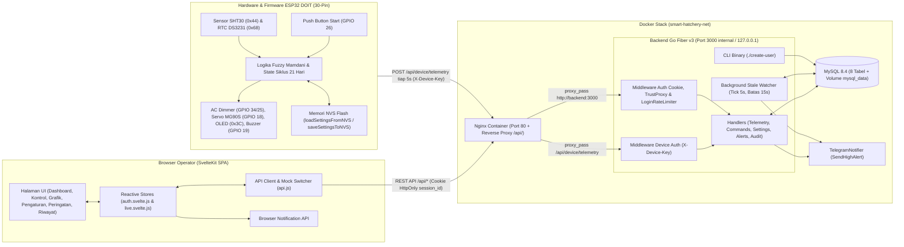
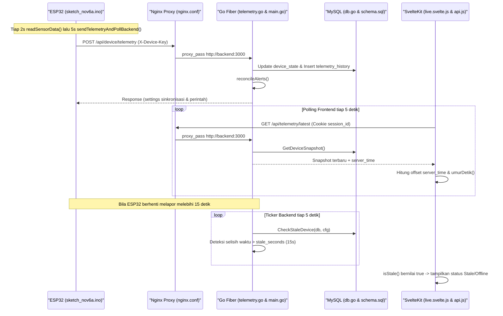
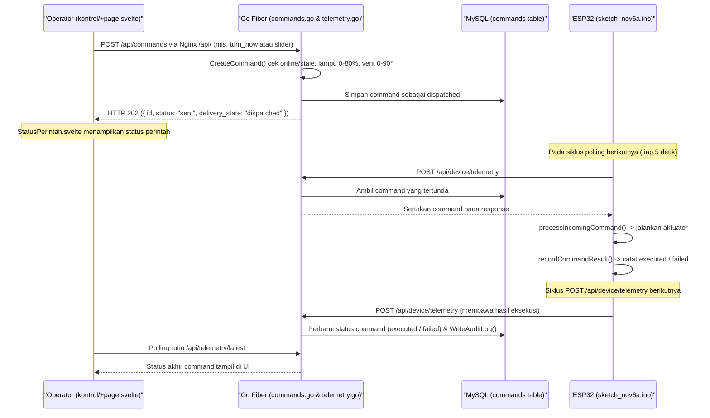

# Dokumentasi Lengkap Sistem Inkubator Telur IoT (Smart Hatchery)

Dokumen ini disusun sebagai panduan belajar menyeluruh untuk memahami kode sumber **Arduino/ESP32**, **Backend Go Fiber v3 + MySQL**, **Frontend SvelteKit**, **Docker & Nginx Reverse Proxy**, cara menambah akun operator baru, hingga panduan lengkap **launching ke VPS produksi** dari workspace `c:\ITIOT`.

---

## 1. Gambaran Umum & Arsitektur Sistem

Sistem ini dirancang untuk memantau dan mengendalikan proses penetasan telur selama **siklus 21 hari** secara otomatis maupun jarak jauh oleh **Operator** (*single role*):
- **Hari 1 – 18 (Fase Pemutaran / *Turning*):** Penjadwalan pemutaran rak telur berjalan sesuai interval yang diatur, bersamaan dengan kendali suhu inkubator.
- **Hari 19 – 21 (Fase *Lockdown*):** Pemutaran rak telur dihentikan demi keamanan embrio menjelang menetas; suhu dan kelembapan tetap dipantau.
- **Batas Suhu Aman:** `36.5°C – 38.5°C` dengan target default `37.5°C`.
- **Peran Kelembapan:** Berfungsi sebagai **indikator keamanan pasif** (tidak ada target kontrol pelembap/humidifier otomatis, namun backend menyediakan batas `hum_min: 45` dan `hum_max: 70`, ESP32 memiliki `HUMIDITY_WARN_MAX = 75.0f` dengan *passive humidity override*, dan UI mendukung `target_humidity` opsional bila tidak bernilai `null`).

### Peta Folder & Teknologi Utama

| Lapisan | Lokasi di Workspace | Teknologi Utama | Peran dalam Sistem |
| :--- | :--- | :--- | :--- |
| **Firmware IoT** | [`ESP/sketch_nov6a/sketch_nov6a.ino`](file:///c:/ITIOT/ESP/sketch_nov6a/sketch_nov6a.ino) & [`ESP/PANDUAN_ARDUINO_DAN_FUZZY.md`](file:///c:/ITIOT/ESP/PANDUAN_ARDUINO_DAN_FUZZY.md) | Arduino C++ (ESP32 DOIT 30-Pin), `ArduinoJson` v7.x | Membaca sensor I2C, menjalankan Logika Fuzzy Mamdani lokal secara real-time, menggerakkan AC Dimmer & Servo MG90S, menampilkan status ke OLED, menyimpan state ke NVS, serta sinkronisasi HTTP ke Backend. |
| **Backend API & CLI** | [`backend/`](file:///c:/ITIOT/backend/README.md) ([`cmd/server/main.go`](file:///c:/ITIOT/backend/cmd/server/main.go), [`cmd/create-user/main.go`](file:///c:/ITIOT/backend/cmd/create-user/main.go)) | Go + Fiber v3 + MySQL | Gerbang keamanan, autentikasi sesi & perangkat, *TrustProxy* untuk *rate limiter*, validasi perintah kontrol, enkripsi Wi-Fi AES-256-GCM, penyimpanan histori telemetri, deteksi *stale* (`15 detik`), notifikasi Telegram, serta CLI injeksi akun operator. |
| **Frontend Web** | [`frontend/`](file:///c:/ITIOT/frontend/README.md) ([`src/routes/+layout.svelte`](file:///c:/ITIOT/frontend/src/routes/+layout.svelte)) | SvelteKit (SPA `ssr=false`), Svelte 5 Runes, Tailwind CSS v4 | Antarmuka operator untuk memantau dashboard live, grafik & evaluasi stabilitas historis, mengirim perintah kontrol, mengatur target & Wi-Fi, melihat peringatan, dan membaca log audit. |
| **Docker & Proxy** | [`docker-compose.yml`](file:///c:/ITIOT/docker-compose.yml), [`.env.docker`](file:///c:/ITIOT/.env.docker), [`backend/Dockerfile`](file:///c:/ITIOT/backend/Dockerfile), [`frontend/Dockerfile`](file:///c:/ITIOT/frontend/Dockerfile), [`frontend/nginx.conf`](file:///c:/ITIOT/frontend/nginx.conf) | Docker Compose, MySQL 8.4, Nginx Alpine | Menjalankan stack 3 container (`mysql`, `backend`, `frontend`), melayani file statis SvelteKit sekaligus melakukan reverse proxy `/api/` ke `backend:3000`. |
| **Spesifikasi** | [`PLAN.md`](file:///c:/ITIOT/PLAN.md), [`PRD_Inkubator_Telur_IoT_Revisi_v2.docx`](file:///c:/ITIOT/PRD_Inkubator_Telur_IoT_Revisi_v2.docx), [`Kontrak_API_Smart_Hatchery_v2_Final.docx`](file:///c:/ITIOT/Kontrak_API_Smart_Hatchery_v2_Final.docx) | Markdown & DOCX | Dokumen rencana awal, kebutuhan produk (PRD v2), dan kontrak struktur JSON API antara Web, Backend, dan ESP32. |

### Diagram Arsitektur Keseluruhan



### Catatan Penyesuaian Hardware Final vs PRD Awal

Pada spesifikasi awal di PRD v2.0 & Kontrak API, sistem sempat mengasumsikan keberadaan **motor DC + sensor Hall encoder** (`PIN_MOTOR_*`) terpisah dari servo ventilasi. Namun pada **revisi final wiring ESP32 DOIT (30-Pin)**, motor stepper/DC pemutar rak ditiadakan dan sistem memakai **1 unit Servo MG90S** (`GPIO 18`) serta **1 unit Push Button Start** (`GPIO 26`).

Agar aplikasi Web Frontend dan Kontrak API Backend tetap kompatibel tanpa perlu menulis ulang antarmuka pengguna, firmware [`sketch_nov6a.ino`](file:///c:/ITIOT/ESP/sketch_nov6a/sketch_nov6a.ino) tetap menyertakan objek `motor` dan field jadwal `turning` di dalam payload JSON telemetri.

---

## 2. Penjelasan Detail Firmware Arduino / ESP32

Kode sumber utama berada di [`ESP/sketch_nov6a/sketch_nov6a.ino`](file:///c:/ITIOT/ESP/sketch_nov6a/sketch_nov6a.ino), disertai panduan setup board, 5 library (termasuk `ArduinoJson` v7.x), dan tabel aturan Fuzzy di [`ESP/PANDUAN_ARDUINO_DAN_FUZZY.md`](file:///c:/ITIOT/ESP/PANDUAN_ARDUINO_DAN_FUZZY.md).

### A. Mapping Pin ESP32 DOIT (30-Pin) & Jalur Daya

Sesuai panduan wiring final:
1. **Jalur Daya Utama:**
   - Pin `VIN` (atau `5V`) ESP32 $\leftarrow$ `+5.0V` Utama (Baut 1 & 2 TB-1512).
   - Pin `GND` ESP32 $\leftarrow$ `GND` Bersama (Baut 3 & 4 TB-1512).
   - Pin `3V3` ESP32 $\rightarrow$ Jalur `+3.3V` Sensor (Baut 7 TB-1512) untuk menyuplai **SHT30**, **OLED SSD1306**, **RTC DS3231SN**, dan **RobotDyn AC Dimmer**.
   - **Jalur Daya Servo MG90S:** Kabel `VCC` (Merah) & `GND` (Cokelat) servo diambil langsung dari Baut `+5.0V` dan `GND` TB-1512, **bukan** dari ESP32.

2. **Tabel Penggunaan GPIO & Alamat I2C:**

| Konstanta di Kode | Pin / Alamat | Arah / Mode | Komponen Terhubung & Catatan |
| :--- | :--- | :--- | :--- |
| `PIN_SERVO_MG90S` | `GPIO 18` | PWM Output | Kabel oranye (Signal) Motor Servo MG90S (`VENT_ANGLE_MIN=0` s.d. `VENT_ANGLE_MAX=90`). |
| `PIN_BUZZER_SFM27` | `GPIO 19` | Digital Output | Kabel merah (+) Buzzer Aktif SFM-27; kabel hitam (-) ke GND Baseplate. |
| `PIN_I2C_SDA` | `GPIO 21` | I2C Data | Dicabang di Baut 5 TB-1512 ke SHT30, OLED, dan RTC. |
| `PIN_I2C_SCL` | `GPIO 22` | I2C Clock | Dicabang di Baut 6 TB-1512 ke SHT30, OLED, dan RTC. |
| `PIN_DIMMER_DIM` | `GPIO 25` | Digital/Pulse Out | Pin `PWM / DIM` RobotDyn AC Dimmer (pemicu intensitas bohlam 60W). |
| `PIN_BTN_START` | `GPIO 26` | `INPUT_PULLUP` | Kaki Pin 1 Push Button Start (1 unit); Pin 2 ke GND Baseplate. |
| `PIN_DIMMER_ZC` | `GPIO 34` | Input Interrupt | Pin `Z-C` (*Zero-Cross Detector*) RobotDyn AC Dimmer. |
| `I2C_ADDR_SHT30` | `0x44` | Alamat I2C | Sensor suhu & kelembapan SHT30-D / SHT31-D. |
| `I2C_ADDR_OLED` | `0x3C` | Alamat I2C | Layar OLED 0.96" SSD1306 (`OLED_WIDTH=128`, `OLED_HEIGHT=64`). |
| `I2C_ADDR_RTC` | `0x68` | Alamat I2C | Modul Jam RTC DS3231SN (pin `SQW` & `32K` dikosongkan). |

### B. Driver RobotDyn AC Dimmer (Interrupt 100 µs & IRAM-Safe)

1. **Prinsip Pembagian Setengah Gelombang AC 50Hz:**
   - Setengah siklus listrik AC 50Hz berdurasi **`10.000 µs`**, yang dibagi menjadi **`100` tick** berdurasi masing-masing **`100 µs`**.
   - `initRobotDynDimmer()` mengonfigurasi timer periodik `onDimmerTickISR()` tiap `100 µs` dan interrupt *zero-cross* `onZeroCrossISR()` pada `GPIO 34` (`PIN_DIMMER_ZC`).
2. **Pemetaan Intensitas (`dimTargetTick`):**
   - `<= 2%`: Lampu mati penuh (**Full OFF**).
   - `>= 98%`: Lampu menyala penuh (**Full ON**).
   - `3% – 97%`: Nilai target tick dihitung melalui `dimTargetTick = map(clamped, 3, 97, 92, 8)`. Semakin besar persentase lampu, semakin kecil `dimTargetTick` sehingga pemicuan terjadi lebih awal dalam setengah siklus.
   - Saat mencapai target tick, ISR memicu pulsa gerbang selebar **`200 µs`** menggunakan akses register cepat `GPIO.out_w1ts` dan `GPIO.out_w1tc` agar tetap aman di dalam konteks interrupt.
3. **Proteksi Penulisan Flash NVS (`dimmerZCPaused`):**
   - Fungsi `loadSettingsFromNVS()` memuat pengaturan tersimpan saat perangkat menyala.
   - Saat menyimpan pengaturan baru melalui `saveSettingsToNVS()`, firmware menyetel **`dimmerZCPaused = true`** selama proses penulisan ke flash NVS agar interrupt zero-cross tidak bertabrakan dengan akses flash ESP32.

### C. Logika Fuzzy Mamdani (2 Input, 2 Output, 9 Aturan) + Pengaman Kelembapan

Untuk menjaga suhu tetap stabil di sekitar target (`TEMP_DEFAULT_TARGET = 37.5f`) dengan logika berbasis bahasa manusia (*linguistic rules*) yang mudah dipahami, firmware mengevaluasi **Logika Fuzzy Mamdani 2-input 2-output** pada fungsi `evaluateFuzzyControl()`:
- **1. Fuzzifikasi Input:** Menggunakan fungsi kurva `fuzzyLeftShoulder()`, `fuzzyTriangle()`, dan `fuzzyRightShoulder()` untuk mengubah **Error Suhu ($e$)** ke 3 himpunan (`ERR_DINGIN`, `ERR_NORMAL`, `ERR_PANAS`) serta **Perubahan Suhu ($\Delta e$)** ke 3 himpunan (`DERR_TURUN`, `DERR_STABIL`, `DERR_NAIK`).
- **2. Basis Aturan Linguistik (`3x3 = 9 Aturan IF-THEN`) & Implikasi `MIN`:** Mengombinasikan 2 input menggunakan operator `MIN` (`AND`) untuk memotong (*clipping*) tinggi kurva himpunan output:
  1. **Himpunan Output Lampu AC Dimmer (`muOutputLamp`):** 5 himpunan linguistik (`LAMP_MATI`, `LAMP_REDUP`, `LAMP_SEDANG`, `LAMP_TERANG`, `LAMP_SANGAT_TERANG`) pada rentang otomatis hingga `LAMP_AUTO_MAX_PCT = 100` (sedangkan kontrol manual dari Web dibatasi pada `LAMP_MANUAL_MAX_PCT = 80`).
  2. **Himpunan Output Servo Ventilasi MG90S (`muOutputVent`):** 5 himpunan linguistik (`VENT_TUTUP`, `VENT_BUKA_KECIL`, `VENT_BUKA_SEDANG`, `VENT_BUKA_LEBAR`, `VENT_BUKA_PENUH`) pada rentang `VENT_ANGLE_MIN = 0°` sampai `VENT_ANGLE_MAX = 90°`.
- **3. Agregasi `MAX` & Defuzzifikasi Centroid (*Center of Area*):** Menggabungkan kurva output yang terpotong dengan operator `MAX`, lalu menghitung titik berat kurva melalui `defuzzifyCentroidLamp()` dan `defuzzifyCentroidVent()` (detail rumus dan matriks tersedia di [`ESP/PANDUAN_ARDUINO_DAN_FUZZY.md`](file:///c:/ITIOT/ESP/PANDUAN_ARDUINO_DAN_FUZZY.md)).
- **4. Pengaman Suhu Ekstrem & Passive Humidity Override:** Memaksa lampu `0%` / ventilasi `90°` jika suhu melewati `TEMP_SAFE_MAX = 38.5f`, serta membuka ventilasi minimal `35°` saat kelembapan melewati `HUMIDITY_WARN_MAX = 75.0f` dan suhu tidak dingin.

### D. Manajemen Waktu, Siklus 21 Hari, Tombol Fisik, & Buzzer

- **Penjaga Waktu (NTP + RTC DS3231):**
  - `getCurrentEpoch()` dan `formatIso8601Utc()` memadukan sinkronisasi waktu internet (`NTP_SERVER_1`, `NTP_SERVER_2`) dan modul **RTC DS3231** (`0x68`).
- **Siklus Inkubasi (`updateIncubationCycle()`):**
  - Mengelola siklus total `INCUBATION_TOTAL_DAYS = 21` dengan fase *lockdown* dimulai pada hari ke-19 (`INCUBATION_LOCKDOWN_START = 19`).
  - Siklus dapat dijalankan dan dihentikan melalui fungsi `startIncubationLocalOrRemote()` dan `stopIncubationLocalOrRemote()`.
- **Pembacaan Tombol (`pollPhysicalSwitches()`):**
  - **Push Button Start (`PIN_BTN_START = 26`):** Tekan singkat (`< 2 detik`) saat inkubator belum berjalan akan memulai siklus 21 hari; tekan tahan lama (`>= 3 detik`) saat sedang berjalan akan menghentikan siklus kembali ke `idle`.
- **Aktuator & Alarm:**
  - `applyLampOutput()`, `applyVentilationOutput()`, `startTurningCycle()`, `stopTurningCycle()`, dan `updateBuzzerAlarm()` (mengendalikan Buzzer Aktif SFM-27 di `GPIO 19`, dengan batas suhu aman `TEMP_SAFE_MIN = 36.5f` s.d. `TEMP_SAFE_MAX = 38.5f` serta batas kelembapan `HUMIDITY_WARN_MAX = 75.0f`).

### E. Siklus Kerja `setup()` dan `loop()` ESP32

1. `readSensorData()` tiap **`2 detik`** (`SENSOR_READ_INTERVAL_MS = 2000UL`) membaca SHT30 (`0x44`).
2. `updateOledDisplay()` tiap **`1 detik`** (`OLED_UPDATE_INTERVAL_MS = 1000UL`) memperbarui tampilan layar OLED `128x64` dengan bahasa ramah awam (Kapan Mulai `DD/MM/YYYY` WIB, Progres Hari `Hari X/21`, Sesi `Putar Telur` / `Tidak Putar` / `Belum Jalan`, Suhu `C`, dan Kelembapan `%`).
3. `sendTelemetryAndPollBackend()` tiap **`5 detik`** (`TELEMETRY_INTERVAL_MS = 5000UL`) mengirim data telemetri ke `BACKEND_TELEMETRY_URL` menggunakan header `X-Device-Key` (`DEVICE_API_KEY`) dan `DEVICE_ID = "inkubator-01"`, sekaligus merakit kondisi perangkat lewat `buildDeviceCondition()`. *(Catatan VPS: arahkan `BACKEND_TELEMETRY_URL` ke IP/domain VPS melalui `/api/device/telemetry`, dan lihat Bagian 7 bila memakai HTTPS).*
4. Saat menerima respons dari Backend, ESP32 menjalankan:
   - **`processIncomingSettings()`:** Menerapkan pengaturan terbaru termasuk pergantian Wi-Fi melalui `applyNewWifiWithRollback()`. Jika gagal tersambung ke Wi-Fi baru dalam batas **`30 detik`** (`WIFI_CONNECT_TIMEOUT_MS = 30000UL`), perangkat melakukan rollback otomatis.
   - **`processIncomingCommand()`:** Mengeksekusi perintah yang masuk dan mencatat status hasilnya melalui `recordCommandResult()` (`executed` / `failed`).

---

## 3. Penjelasan Detail Backend Go Fiber v3 & MySQL

Backend berada di folder [`backend/`](file:///c:/ITIOT/backend/README.md) dan menggunakan arsitektur terstruktur antara entrypoint, CLI administrasi, konfigurasi, kriptografi, middleware, database, service, dan handler.

### A. Peta File Backend (`backend/`)

- [`cmd/server/main.go`](file:///c:/ITIOT/backend/cmd/server/main.go):
  - Menginisialisasi aplikasi Fiber v3 dengan `ProxyHeader: fiber.HeaderXForwardedFor`, `TrustProxy: true`, dan `TrustProxyConfig` (`Loopback: true`, `Private: true`, `LinkLocal: true`) sehingga `c.IP()` pada rate limiter membaca IP asli klien di balik Nginx/Caddy VPS, bukan IP container bridge Docker.
  - Memanggil `warnWeakProductionDefaults(cfg)` untuk mencetak peringatan log bila `APP_ENV=production` masih memakai `DEVICE_API_KEY` bawaan atau `COOKIE_SECURE=false`.
  - Memasang middleware global (`recover`, `logger`, `cors`), seluruh rute `/api`, ticker latar belakang tiap `5 detik` (`handlers.CheckStaleDevice(db, cfg)`), serta *graceful shutdown*.
- [`cmd/create-user/main.go`](file:///c:/ITIOT/backend/cmd/create-user/main.go): CLI manajemen akun operator (`upsertUser`) untuk menambah akun baru atau mereset kata sandi akun yang sudah ada dengan hash Argon2id (diuji di [`cmd/create-user/main_test.go`](file:///c:/ITIOT/backend/cmd/create-user/main_test.go)).
- [`internal/config/config.go`](file:///c:/ITIOT/backend/internal/config/config.go): Struct `Config`, fungsi `Load()` (referensi di [`backend/.env.example`](file:///c:/ITIOT/backend/.env.example)), dan `parseEncryptionKey()` yang menerima kunci hex 64-karakter atau fallback hash SHA-256.
- [`internal/database/schema.sql`](file:///c:/ITIOT/backend/internal/database/schema.sql) & [`internal/database/db.go`](file:///c:/ITIOT/backend/internal/database/db.go):
  - `Connect()` sekarang mencoba koneksi langsung ke database target (`appDSN`) terlebih dulu agar kompatibel dengan user database VPS/Docker yang hak aksesnya dibatasi hanya pada database aplikasi (`smart_hatchery`), lalu melakukan fallback ke `rootDSN` + `CREATE DATABASE IF NOT EXISTS` hanya jika database belum tersedia (seperti pada XAMPP lokal).
  - Menjalankan `runMigrations()`, `seedDefaults()` (otomatis mengisi user awal `OPERATOR_USERNAME`/`OPERATOR_PASSWORD` saat tabel `users` kosong), dan `WriteAuditLog()`.
- [`internal/models/models.go`](file:///c:/ITIOT/backend/internal/models/models.go): Definisi struct data untuk database dan komunikasi API.
- [`internal/crypto/`](file:///c:/ITIOT/backend/internal/crypto/crypto_test.go):
  - [`argon2.go`](file:///c:/ITIOT/backend/internal/crypto/argon2.go): `HashPassword()` & `VerifyPassword()` memakai format PHC `$argon2id$v=19$m=65536,t=3,p=2$...` dan `subtle.ConstantTimeCompare`.
  - [`aesgcm.go`](file:///c:/ITIOT/backend/internal/crypto/aesgcm.go): `EncryptAESGCM()` & `DecryptAESGCM()` memakai 12-byte random nonce.
- [`internal/middleware/`](file:///c:/ITIOT/backend/internal/middleware/ratelimit_test.go):
  - [`auth.go`](file:///c:/ITIOT/backend/internal/middleware/auth.go): Mendefinisikan `SessionCookieName = "session_id"`, `HashToken()`, `RequireAuth()`, dan `CurrentUser()` dengan cookie `HttpOnly` dan `SameSite=Strict` (serta `Secure` sesuai `COOKIE_SECURE`).
  - [`ratelimit.go`](file:///c:/ITIOT/backend/internal/middleware/ratelimit.go): `LoginRateLimiter` yang membatasi maksimal **5 kegagalan per menit** dan mengembalikan HTTP `429` jika melampaui batas.
  - [`device_auth.go`](file:///c:/ITIOT/backend/internal/middleware/device_auth.go): `RequireDeviceKey()` memvalidasi header `X-Device-Key` dari ESP32.
- [`internal/services/telegram.go`](file:///c:/ITIOT/backend/internal/services/telegram.go): `TelegramNotifier` & `SendHighAlert()` mengirim HTTP POST asinkron ke `api.telegram.org`.
- [`internal/handlers/`](file:///c:/ITIOT/backend/internal/handlers/auth.go):
  - [`auth.go`](file:///c:/ITIOT/backend/internal/handlers/auth.go): `AuthHandler` (`Login`, `Logout`, `Me`).
  - [`telemetry.go`](file:///c:/ITIOT/backend/internal/handlers/telemetry.go): `TelemetryHandler` (`GetLatest`, `GetHistory`, `IngestDeviceTelemetry`, `reconcileAlerts`, `loadSettingsSync`, `GetDeviceSnapshot`, `CheckStaleDevice`).
  - [`commands.go`](file:///c:/ITIOT/backend/internal/handlers/commands.go): `CommandsHandler` (`CreateCommand`).
  - [`settings.go`](file:///c:/ITIOT/backend/internal/handlers/settings.go): `SettingsHandler` (`GetDeviceSettings`, `GetLimits`, `GetThresholds`, `UpdateTargetTemperature`, `UpdateMotorSettings`, `UpdateWifiSettings`).
  - [`alerts_audit.go`](file:///c:/ITIOT/backend/internal/handlers/alerts_audit.go): `AlertsAuditHandler` (`GetAlerts`, `GetAuditLogs`).

### B. Skema 8 Tabel Database MySQL

Dikelola melalui [`schema.sql`](file:///c:/ITIOT/backend/internal/database/schema.sql) dan [`db.go`](file:///c:/ITIOT/backend/internal/database/db.go):

| Nama Tabel | Peran dalam Sistem |
| :--- | :--- |
| `users` | Data akun Operator dengan password ter-hash Argon2id. |
| `sessions` | Token sesi ter-hash (`HashToken()`) untuk validasi cookie `session_id`. |
| `device_settings` | Pengaturan perangkat, termasuk kredensial Wi-Fi terenkripsi AES-256-GCM dan penanda sinkronisasi `wifi_sync_pending`. |
| `device_state` | Snapshot kondisi terkini perangkat (termasuk `updated_at` untuk pemantauan batas *stale* 15 detik). |
| `telemetry_history` | Catatan deret waktu telemetri untuk kebutuhan grafik historis. |
| `commands` | Antrean perintah yang dikirim ke ESP32 beserta status pengiriman/eksekusinya (`dispatched`, `executed`, `failed`). |
| `alerts` | Daftar peringatan sistem dengan status `active` maupun `resolved`. |
| `audit_logs` | Log audit yang dicatat via `WriteAuditLog()` untuk ditelusuri Operator. |

### C. Daftar Rute API Backend (`/api`)

| Grup / Rute API | Proteksi Middleware | Handler & Penjelasan |
| :--- | :--- | :--- |
| `GET /api/health` | Publik | Endpoint pemeriksaan kesehatan server & ping MySQL (terdaftar di [`main.go`](file:///c:/ITIOT/backend/cmd/server/main.go)). |
| `POST /api/auth/login`, `POST /api/auth/logout` | Publik + `LoginRateLimiter` pada login | [`AuthHandler`](file:///c:/ITIOT/backend/internal/handlers/auth.go) (`Login`, `Logout`): verifikasi Argon2id, batas 5 gagal/menit (HTTP `429`), manajemen cookie `session_id`. |
| `GET /api/auth/me` | `RequireAuth(db)` | `AuthHandler.Me`: mengembalikan profil user yang sedang login. |
| `POST /api/device/telemetry` | `RequireDeviceKey` | [`TelemetryHandler.IngestDeviceTelemetry`](file:///c:/ITIOT/backend/internal/handlers/telemetry.go): menerima data ESP32, memperbarui state & histori, menjalankan `reconcileAlerts()`, memanggil `loadSettingsSync()`, dan menyertakan perintah tertunda. |
| `GET /api/telemetry/latest` | `RequireAuth(db)` | `TelemetryHandler.GetLatest`: membaca `GetDeviceSnapshot()` dan menyertakan `server_time`. |
| `GET /api/telemetry/history` | `RequireAuth(db)` | `TelemetryHandler.GetHistory`: mengambil histori berdasar parameter `from`, `to`, dan `max_points` menggunakan *bucketing downsampling*. |
| `POST /api/commands` | `RequireAuth(db)` | [`CommandsHandler.CreateCommand`](file:///c:/ITIOT/backend/internal/handlers/commands.go): memvalidasi perangkat harus online/tidak stale, batas lampu `0–80%`, ventilasi `0–90°`, serta pra-kondisi *turning*; mengembalikan HTTP `202` `{ id, status: "sent", delivery_state: "dispatched" }`. |
| `GET /api/settings/device`, `GET /api/settings/limits` | `RequireAuth(db)` | [`SettingsHandler`](file:///c:/ITIOT/backend/internal/handlers/settings.go) (`GetDeviceSettings`, `GetLimits`): membaca pengaturan perangkat (*write-only* untuk password Wi-Fi) dan batasan operasional. |
| `GET /api/settings/thresholds` | `RequireAuth(db)` | `SettingsHandler.GetThresholds`: mengembalikan `temp_min: 36.5`, `temp_max: 38.5`, `hum_min: 45`, `hum_max: 70`, dan `stale_seconds: cfg.StaleSeconds`. |
| `PUT /api/settings/target-temperature` | `RequireAuth(db)` | `SettingsHandler.UpdateTargetTemperature`: memperbarui suhu target inkubasi. |
| `PUT /api/settings/motor` | `RequireAuth(db)` | `SettingsHandler.UpdateMotorSettings`: memperbarui pengaturan motor/jadwal pemutaran (mendukung payload penuh maupun parsial seperti `{ interval_minutes }` dari frontend). |
| `PUT /api/settings/wifi` | `RequireAuth(db)` | `SettingsHandler.UpdateWifiSettings`: mengenkripsi kredensial Wi-Fi memakai AES-256-GCM dan menyetel `wifi_sync_pending = 1`. |
| `GET /api/alerts`, `GET /api/audit-logs` | `RequireAuth(db)` | [`AlertsAuditHandler`](file:///c:/ITIOT/backend/internal/handlers/alerts_audit.go) (`GetAlerts`, `GetAuditLogs`): mendukung filter & paginasi server-side (`from`, `to`, `event`, `page`, `limit`). |

### D. Cara Injeksi Akun Operator Baru / Reset Kata Sandi (`create-user` CLI)

Karena fungsi `seedDefaults()` di [`db.go`](file:///c:/ITIOT/backend/internal/database/db.go) hanya mengisi 1 akun awal saat tabel `users` kosong (dan tidak ada endpoint registrasi publik demi keamanan alat IoT), penambahan akun operator kedua atau reset kata sandi dilakukan secara aman melalui CLI [`backend/cmd/create-user/main.go`](file:///c:/ITIOT/backend/cmd/create-user/main.go):

- **Validasi bawaan CLI:** username `3–64` karakter tanpa spasi, kata sandi `8–128` karakter, role `'operator'`, otomatis di-hash dengan **Argon2id**, dan tercatat ke `audit_logs`.
- **Menambah akun baru via Docker (Lokal maupun VPS):**
  ```bash
  docker exec -it smart-hatchery-backend ./create-user -username operator2 -password PasswordBaru123
  ```
- **Mengubah kata sandi akun yang sudah ada (pakai flag `-update`):**
  ```bash
  docker exec -it smart-hatchery-backend ./create-user -username operator1 -password PasswordBaru123 -update
  ```
- **Menjalankan langsung via Go (tanpa Docker):**
  ```powershell
  cd c:\ITIOT\backend
  go run ./cmd/create-user -username operator2 -password PasswordBaru123
  ```

---

## 4. Penjelasan Detail Frontend SvelteKit & Nginx

Kode frontend berada di [`frontend/`](file:///c:/ITIOT/frontend/README.md) menggunakan **SvelteKit (Svelte 5 Runes)** dan **Tailwind CSS v4**.

### A. Konfigurasi SPA, Vite Dev Proxy, Nginx Production Proxy & Mode Mock

- **Mode SPA Murni:** [`src/routes/+layout.js`](file:///c:/ITIOT/frontend/src/routes/+layout.js) menetapkan `ssr = false` dan [`svelte.config.js`](file:///c:/ITIOT/frontend/svelte.config.js) memakai `@sveltejs/adapter-static` (`fallback: 'index.html'`).
- **Saat Development Lokal (`npm run dev`):** [`vite.config.js`](file:///c:/ITIOT/frontend/vite.config.js) mem-proxy `/api` menuju `http://localhost:3000`. Mode mock vs backend diatur melalui `VITE_USE_MOCK=true/false` (lihat [`.env.example`](file:///c:/ITIOT/frontend/.env.example)).
- **Saat Production Docker ([`frontend/Dockerfile`](file:///c:/ITIOT/frontend/Dockerfile) + [`frontend/nginx.conf`](file:///c:/ITIOT/frontend/nginx.conf)):**
  - `Dockerfile` membangun static bundle dengan `ENV VITE_USE_MOCK=false`.
  - Nginx mendengarkan IPv4 (`listen 80;`) dan IPv6 (`listen [::]:80;`), sehingga healthcheck container maupun akses lokal berjalan konsisten.
  - Blok `location ^~ /api/` meneruskan seluruh request `/api/*` ke `http://backend:3000` dengan header `Host`, `X-Real-IP`, `X-Forwarded-For`, `X-Forwarded-Proto`, serta `Cache-Control "no-store"` (mencegah error `405` karena request API tidak jatuh ke static `try_files ... /index.html`).
  - Dilengkapi `server_tokens off;`, `gzip on;`, `client_max_body_size 1m;`, serta header keamanan (`X-Content-Type-Options`, `X-Frame-Options`, `Referrer-Policy`).

### B. State Management Reaktif & Utilitas Frontend

- **API & Mock:** [`src/lib/api.js`](file:///c:/ITIOT/frontend/src/lib/api.js) (`BASE = '/api'`, `credentials: 'include'`, callback 401, `getHistory({ from, to, maxPoints })`, `saveTargetHumidity`, dan pembacaan `server_time`) serta skenario dummy di [`src/lib/mock/telemetry.js`](file:///c:/ITIOT/frontend/src/lib/mock/telemetry.js) (`telemetryNormal`, `telemetryStale`, `telemetryAlert`, `telemetryDone`, mock alerts, `auditLogs`, dan `users`).
- **Stores Svelte 5 Runes:**
  - [`src/lib/auth.svelte.js`](file:///c:/ITIOT/frontend/src/lib/auth.svelte.js): `$state({ user: null, siap: false })`, `initAuth()`, `masuk()`, `keluar()`.
  - [`src/lib/live.svelte.js`](file:///c:/ITIOT/frontend/src/lib/live.svelte.js): Polling telemetri tiap **`5 detik`**, alert tiap **`10 detik`**, dan jam internal tiap **`1 detik`**, menghitung offset `server_time` untuk `umurDetik()` / `isStale()`, serta memicu Browser `Notification` (`alertTerlihat`).
  - [`src/lib/transisi.svelte.js`](file:///c:/ITIOT/frontend/src/lib/transisi.svelte.js): Transisi animasi oranye login ke dashboard (`trans`, `siapAnimasi()`).
- **Utilitas:** [`format.js`](file:///c:/ITIOT/frontend/src/lib/format.js), [`turning.js`](file:///c:/ITIOT/frontend/src/lib/turning.js), [`level.js`](file:///c:/ITIOT/frontend/src/lib/level.js), dan [`stabilitas.js`](file:///c:/ITIOT/frontend/src/lib/stabilitas.js) (`hitungStabilitas` dengan rumus $0.7 \times \text{dalam} + 0.3 \times \text{skorRmse}$ serta `cariKejadian`).
- **Rute Halaman (`src/routes/`):**
  - [`+layout.svelte`](file:///c:/ITIOT/frontend/src/routes/+layout.svelte) & [`login/+page.svelte`](file:///c:/ITIOT/frontend/src/routes/login/+page.svelte)
  - [`+page.svelte`](file:///c:/ITIOT/frontend/src/routes/+page.svelte) (Dashboard: [`IncubationCard.svelte`](file:///c:/ITIOT/frontend/src/lib/components/IncubationCard.svelte), [`Gauge.svelte`](file:///c:/ITIOT/frontend/src/lib/components/Gauge.svelte), [`MetricCard.svelte`](file:///c:/ITIOT/frontend/src/lib/components/MetricCard.svelte), [`LineChart.svelte`](file:///c:/ITIOT/frontend/src/lib/components/LineChart.svelte), [`TurningCard.svelte`](file:///c:/ITIOT/frontend/src/lib/components/TurningCard.svelte))
  - [`kontrol/+page.svelte`](file:///c:/ITIOT/frontend/src/routes/kontrol/+page.svelte) ([`StatusPerintah.svelte`](file:///c:/ITIOT/frontend/src/lib/components/StatusPerintah.svelte))
  - [`grafik/+page.svelte`](file:///c:/ITIOT/frontend/src/routes/grafik/+page.svelte) (rentang `1j`, `6j`, `24j`, `7h`, refresh `30 detik`, 3 `LineChart`, 2 [`EvaluasiKartu.svelte`](file:///c:/ITIOT/frontend/src/lib/components/EvaluasiKartu.svelte))
  - [`pengaturan/+page.svelte`](file:///c:/ITIOT/frontend/src/routes/pengaturan/+page.svelte) ([`TargetForm.svelte`](file:///c:/ITIOT/frontend/src/lib/components/TargetForm.svelte), form `{ interval_minutes }` ke `PUT /api/settings/motor`, form Wi-Fi *write-only*, izin notifikasi)
  - [`peringatan/+page.svelte`](file:///c:/ITIOT/frontend/src/routes/peringatan/+page.svelte) & [`riwayat/+page.svelte`](file:///c:/ITIOT/frontend/src/routes/riwayat/+page.svelte) (`PER_HALAMAN = 15`)
  - Komponen tambahan: [`StatusBadge.svelte`](file:///c:/ITIOT/frontend/src/lib/components/StatusBadge.svelte) dan [`Ikon.svelte`](file:///c:/ITIOT/frontend/src/lib/components/Ikon.svelte).

---

## 5. Hubungan Antar-Bagian & Alur Data End-to-End

### Alur 1: Pengiriman Telemetri & Deteksi Offline (*Stale*) 15 Detik



### Alur 2: Eksekusi Perintah Kontrol (`dispatched` -> `executed` / `failed`)



### Alur 3: Sinkronisasi Pengaturan & Penggantian Wi-Fi dengan Rollback 30 Detik

1. Operator mengisi SSID dan password Wi-Fi baru (*write-only*) pada [`pengaturan/+page.svelte`](file:///c:/ITIOT/frontend/src/routes/pengaturan/+page.svelte), lalu mengirimkannya ke `PUT /api/settings/wifi`.
2. [`UpdateWifiSettings`](file:///c:/ITIOT/backend/internal/handlers/settings.go) mengenkripsi kredensial memakai `EncryptAESGCM()` dari [`aesgcm.go`](file:///c:/ITIOT/backend/internal/crypto/aesgcm.go), menyimpannya ke `device_settings`, dan menandai `wifi_sync_pending = 1`.
3. Ketika ESP32 mengirim `POST /api/device/telemetry`, `loadSettingsSync()` memuat pengaturan tertunda agar diterima ESP32.
4. Di ESP32, `processIncomingSettings()` memanggil `applyNewWifiWithRollback()` dengan timeout `WIFI_CONNECT_TIMEOUT_MS = 30000UL` (`30 detik`) dan otomatis melakukan rollback jika koneksi baru gagal.

### Alur 4: Sistem Peringatan Multi-Kanal

Apabila suhu keluar rentang `36.5°C – 38.5°C`, kelembapan melewati batas (`HUMIDITY_WARN_MAX = 75.0f` pada ESP32 / threshold backend), atau ESP32 offline melewati `15 detik`:
1. **Lokal (ESP32):** OLED SSD1306 (`0x3C`) menampilkan peringatan dan `updateBuzzerAlarm()` membunyikan Buzzer SFM-27 (`GPIO 19`).
2. **Backend & Telegram:** `reconcileAlerts()` dan `CheckStaleDevice()` mengelola status `active` / `resolved` pada `alerts`, sementara [`TelegramNotifier.SendHighAlert()`](file:///c:/ITIOT/backend/internal/services/telegram.go) mengirim pesan asinkron ke `api.telegram.org`.
3. **Web Operator:** `live.svelte.js` memantau alert pada polling `10 detik`, memperbarui lencana `+layout.svelte`, serta memicu Browser `Notification` dengan pelacakan `alertTerlihat`.

---

## 6. Panduan Urutan Belajar Kode

1. **Pahami Aturan Bisnis:** [`PLAN.md`](file:///c:/ITIOT/PLAN.md) & [`ESP/PANDUAN_ARDUINO_DAN_FUZZY.md`](file:///c:/ITIOT/ESP/PANDUAN_ARDUINO_DAN_FUZZY.md).
2. **Firmware ESP32 ([`sketch_nov6a.ino`](file:///c:/ITIOT/ESP/sketch_nov6a/sketch_nov6a.ino)):** Pin mapping -> ISR AC Dimmer (`onDimmerTickISR`, `onZeroCrossISR`) -> `evaluateFuzzyControl()` -> `loop()` & `sendTelemetryAndPollBackend()`.
3. **Backend ([`main.go`](file:///c:/ITIOT/backend/cmd/server/main.go)):** Registrasi rute & `TrustProxy` -> [`db.go`](file:///c:/ITIOT/backend/internal/database/db.go) & [`schema.sql`](file:///c:/ITIOT/backend/internal/database/schema.sql) -> middleware (`auth.go`, `ratelimit.go`, `device_auth.go`) -> handler [`telemetry.go`](file:///c:/ITIOT/backend/internal/handlers/telemetry.go) & [`commands.go`](file:///c:/ITIOT/backend/internal/handlers/commands.go) -> CLI [`create-user`](file:///c:/ITIOT/backend/cmd/create-user/main.go).
4. **Frontend & Proxy ([`frontend/`](file:///c:/ITIOT/frontend/README.md)):** [`nginx.conf`](file:///c:/ITIOT/frontend/nginx.conf) / [`vite.config.js`](file:///c:/ITIOT/frontend/vite.config.js) -> [`src/lib/api.js`](file:///c:/ITIOT/frontend/src/lib/api.js) -> [`live.svelte.js`](file:///c:/ITIOT/frontend/src/lib/live.svelte.js) & [`auth.svelte.js`](file:///c:/ITIOT/frontend/src/lib/auth.svelte.js) -> halaman UI.

---

## 7. Checklist & Panduan Siap Launching di VPS

[`docker-compose.yml`](file:///c:/ITIOT/docker-compose.yml), [`.env.docker`](file:///c:/ITIOT/.env.docker), [`backend/Dockerfile`](file:///c:/ITIOT/backend/Dockerfile), [`frontend/Dockerfile`](file:///c:/ITIOT/frontend/Dockerfile), dan [`frontend/nginx.conf`](file:///c:/ITIOT/frontend/nginx.conf) sudah dikonfigurasi agar aman di VPS:
- Port MySQL (`127.0.0.1:3306:3306`) dan Go Fiber mentah (`127.0.0.1:3000:3000`) **hanya terikat ke `localhost` VPS** (tidak terbuka ke internet publik).
- Seluruh akses eksternal Web dan API ESP32 melewati container Nginx (`smart-hatchery-frontend`), dengan `TrustProxy` aktif di Go Fiber agar pembatasan login tetap akurat per IP pengunjung asli.
- File `.env` sensitif diabaikan saat build Docker melalui [`backend/.dockerignore`](file:///c:/ITIOT/backend/.dockerignore) dan [`frontend/.dockerignore`](file:///c:/ITIOT/frontend/.dockerignore).

### Langkah-Langkah Deploy di VPS

1. **Siapkan `.env` Produksi dari [`.env.docker`](file:///c:/ITIOT/.env.docker):**
   Di folder proyek pada VPS, salin `.env.docker` menjadi `.env` (Docker Compose otomatis membaca `.env`), lalu **wajib ganti nilai berikut**:
   - `MYSQL_ROOT_PASSWORD` & `DB_PASSWORD`: gunakan password acak yang panjang.
   - `APP_ENCRYPTION_KEY`: buat 64 karakter hex acak (`openssl rand -hex 32`).
   - `DEVICE_API_KEY`: buat token acak panjang, lalu samakan nilainya di [`sketch_nov6a.ino`](file:///c:/ITIOT/ESP/sketch_nov6a/sketch_nov6a.ino).
   - `OPERATOR_PASSWORD`: ganti dari `operator12345` ke kata sandi kuat sebelum start pertama.
   - `TELEGRAM_BOT_TOKEN` & `TELEGRAM_CHAT_ID` (opsional, untuk notifikasi darurat).

2. **Pilih Mode Akses Web (Tanpa Domain vs Pakai Domain + HTTPS):**
   - **Opsi A — Langsung Pakai IP VPS (`http://IP_VPS`):**
     - `FRONTEND_PORT_BIND=80:80`
     - `COOKIE_SECURE=false` *(wajib `false` jika belum memakai HTTPS, karena browser memblokir cookie `Secure` pada HTTP biasa)*
     - `CORS_ALLOW_ORIGINS=http://IP_VPS`
     - Di ESP32, ubah `BACKEND_TELEMETRY_URL` menjadi `http://IP_VPS/api/device/telemetry`.
   - **Opsi B — Pakai Domain + HTTPS (Direkomendasikan untuk Produksi):**
     - Pasang reverse proxy TLS di host VPS (misalnya **Caddy** atau **Nginx + Certbot**) untuk `https://domain-anda.com`, lalu teruskan traffic ke `127.0.0.1:8080`.
     - Pada `.env` Docker Compose, atur:
       - `FRONTEND_PORT_BIND=127.0.0.1:8080:80`
       - `COOKIE_SECURE=true`
       - `CORS_ALLOW_ORIGINS=https://domain-anda.com`
     - **Catatan Penting ESP32:** Fungsi `sendTelemetryAndPollBackend()` di [`sketch_nov6a.ino`](file:///c:/ITIOT/ESP/sketch_nov6a/sketch_nov6a.ino) saat ini memakai `http.begin(BACKEND_TELEMETRY_URL)` (mode HTTP biasa). Jika domain VPS memaksa redirect `http://` $\rightarrow$ `https://`, maka pastikan endpoint `/api/device/telemetry` tetap dapat diakses oleh ESP32 (misalnya lewat `http://IP_VPS:80/api/device/telemetry` tanpa paksa redirect, atau sesuaikan firmware ESP32 agar memakai `WiFiClientSecure` untuk URL `https://`).

3. **Firewall VPS (mis. UFW di Ubuntu):**
   - Buka hanya port yang diperlukan: `22/tcp` (SSH), `80/tcp` (HTTP), dan `443/tcp` (HTTPS bila memakai domain SSL).
   - Jangan membuka port `3306` maupun `3000` ke publik.

4. **Jalankan Stack Docker & Verifikasi:**
   ```bash
   docker compose up -d --build
   docker compose ps
   ```
   Pastikan seluruh container (`smart-hatchery-mysql`, `smart-hatchery-backend`, `smart-hatchery-frontend`) berstatus `healthy`.

5. **Backup Database Rutin di VPS:**
   ```bash
   docker exec smart-hatchery-mysql mysqldump -u hatchery_user -p"PASSWORD_DB" smart_hatchery > backup_hatchery.sql
   ```
