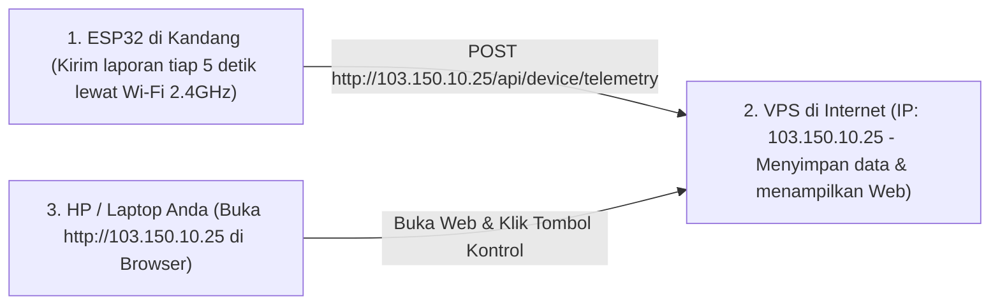

# Panduan Super Mudah: Deploy ke VPS & Menghubungkan ESP32 (Dari Nol Sampai Online)

Panduan ini ditulis langkah demi langkah tanpa istilah rumit. Ikuti urut dari **Tahap 1** sampai **Tahap 3**.

---

## Gambaran Cara Kerja (Pahami dalam 30 Detik)

Bayangkan sistem ini seperti **Kantor Ekspedisi**:
1. **VPS (Server di Internet):** Adalah **Kantor Pusat** yang menyala 24 jam dan punya alamat IP publik (misalnya kita anggap IP VPS Anda adalah **`103.150.10.25`**).
2. **ESP32 (Alat Inkubator):** Adalah **Kurir di Kandang** yang numpang internet lewat **Wi-Fi Rumah / Hotspot HP** untuk mengirim laporan suhu setiap **5 detik** ke alamat Kantor Pusat (`http://103.150.10.25/api/device/telemetry`).
3. **Laptop / HP Anda:** Membuka alamat Kantor Pusat (`http://103.150.10.25`) di Chrome untuk memantau suhu dan menekan tombol perintah.



> **Kunci Penting:** Karena memakai VPS yang ada di internet, **ESP32 dan HP/Laptop Anda TIDAK perlu berada di Wi-Fi yang sama!** ESP32 bisa di rumah/kandang pakai Wi-Fi A, sedangkan Anda bisa memantaunya dari luar kota pakai kuota HP.

---

## KHUSUS PENGGUNA TAILSCALE: Cara Menghubungkan VPS & ESP32

Jika VPS Anda menggunakan **Tailscale** (yang memiliki IP berawalan `100.x.y.z`, misalnya `100.85.12.34`), ada **1 Fakta Penting** yang wajib Anda ketahui:

> **Papan mikrokontroler ESP32 TIDAK BISA diinstal aplikasi Tailscale di dalamnya.**
> Artinya, jika ESP32 hanya nyambung ke Wi-Fi rumah/Hotspot HP biasa, ESP32 **tidak kenal** alamat IP Tailscale `100.x.y.z`!

Supaya **ESP32 tetap bisa mengirim data ke VPS Tailscale Anda**, pilih **salah satu dari 2 cara super mudah** di bawah ini:

### Cara A (Paling Direkomendasikan jika VPS tidak punya IP Public): Pakai **Tailscale Funnel**
Tailscale punya fitur gratis bernama **Funnel** yang membuatkan pintu alamat internet resmi (`https://nama-vps.tailxxxx.ts.net`) menuju VPS Anda sehingga **ESP32 bisa masuk tanpa perlu aplikasi Tailscale**.

1. **Aktifkan HTTPS & Funnel di Dashboard Tailscale Anda (Sekali Saja):**
   - Buka [https://login.tailscale.com/admin/dns](https://login.tailscale.com/admin/dns) $\rightarrow$ pastikan **MagicDNS** aktif dan klik **Enable HTTPS**.
   - Buka tab **Access Controls (ACL)** di web Tailscale, pastikan ada izin `funnel` (biasanya sudah ada atau klik *Add Funnel policy*).
2. **Di Terminal VPS Anda, ketik 1 perintah ini:**
   ```bash
   tailscale funnel --bg 80
   ```
   Terminal akan memunculkan alamat seperti:
   `https://nama-vps.tail12345.ts.net/`
3. **Di File `.env` VPS (`/opt/smart-hatchery/.env`), isi `CORS_ALLOW_ORIGINS` dengan:**
   ```env
   CORS_ALLOW_ORIGINS=http://100.85.12.34,https://nama-vps.tail12345.ts.net
   ```
   *(Ganti `100.85.12.34` dengan IP Tailscale VPS Anda, dan `https://nama-vps.tail12345.ts.net` dengan alamat Funnel Anda, lalu jalankan `docker compose up -d`).*
4. **Di Kodingan Arduino (`sketch_nov6a.ino` Baris 70), isi `BACKEND_TELEMETRY_URL` dengan alamat Funnel tersebut:**
   ```cpp
   const char* BACKEND_TELEMETRY_URL = "https://nama-vps.tail12345.ts.net/api/device/telemetry";
   ```
   *(Kodingan `sketch_nov6a.ino` sudah dilengkapi `WiFiClientSecure` sehingga langsung mendukung `https://` Tailscale Funnel!).*

---

### Cara B (Jika VPS Anda Punya IP Public Sekaligus Tailscale)
Jika VPS Anda adalah VPS Cloud biasa (seperti Biznet Gio, IDCloudHost, DigitalOcean, Vultr, Contabo) yang punya **IP Public** (misal `103.150.10.25`) DAN Anda juga memasang **Tailscale** (`100.85.12.34`):
1. **Untuk Anda (SSH & Buka Web Dashboard):** Anda tetap bebas memakai IP Tailscale **`http://100.85.12.34`**.
2. **Di File `.env` VPS (`/opt/smart-hatchery/.env`):** Tulis kedua IP di `CORS_ALLOW_ORIGINS` (dipisah koma tanpa spasi):
   ```env
   CORS_ALLOW_ORIGINS=http://100.85.12.34,http://103.150.10.25
   ```
3. **Khusus di Kodingan Arduino (`sketch_nov6a.ino` Baris 70):** Gunakan **IP Public VPS** agar ESP32 bisa menjangkaunya dari Wi-Fi mana saja:
   ```cpp
   const char* BACKEND_TELEMETRY_URL = "http://103.150.10.25/api/device/telemetry";
   ```

---

## TAHAP 1: Menyalakan Server di VPS (Di Laptop Anda)

### Langkah 1.1 — Siapkan 3 Data dari Penyedia VPS
Saat Anda menyewa VPS (pilih OS **Ubuntu 22.04** atau **Ubuntu 24.04**), penyedia VPS akan memberikan 3 informasi ini:
1. **IP Address VPS** (Contoh di panduan ini: `103.150.10.25` — *ganti dengan IP asli VPS Anda*)
2. **Username:** `root`
3. **Password:** *(kata sandi root dari VPS Anda)*

---

### Langkah 1.2 — Masuk ke Dalam Komputer VPS
1. Di laptop Windows Anda, tekan tombol **`Windows`** di keyboard, ketik **`PowerShell`**, lalu tekan **Enter**.
2. Ketik perintah berikut (ganti `103.150.10.25` dengan IP VPS Anda), lalu tekan **Enter**:
   ```bash
   ssh root@103.150.10.25
   ```
3. Jika muncul pertanyaan `Are you sure you want to continue connecting (yes/no/[fingerprint])?`, ketik **`yes`** lalu tekan **Enter**.
4. Akan muncul permintaan `root@103.150.10.25's password:`.
   > **PERHATIAN PENTING:** Saat Anda mengetik atau *paste* (klik kanan) password di layar hitam Linux, **memang tidak akan muncul huruf atau tanda bintang `***` sama sekali** (layar terlihat diam). Itu normal demi keamanan. Cukup ketik/klik kanan password Anda, lalu langsung tekan **Enter**.
5. Jika berhasil, tulisan di awal baris terminal Anda akan berubah menjadi seperti `root@nama-vps:~#`. Artinya Anda sudah berada di dalam komputer VPS!

---

### Langkah 1.3 — Instal Docker & Git di VPS (Cukup Copy-Paste)
Copy semua 4 baris di bawah ini sekaligus, klik kanan di layar PowerShell VPS Anda, lalu tekan **Enter** (tunggu sekitar 1–2 menit sampai selesai):

```bash
apt update && apt upgrade -y
apt install -y ca-certificates curl git ufw
curl -fsSL https://get.docker.com | sh
docker compose version
```
Jika di akhir muncul tulisan `Docker Compose version v2.x.x`, berarti Docker sudah siap!

---

### Langkah 1.4 — Ambil Kodingan Proyek dari GitHub ke VPS
Copy-paste perintah ini ke terminal VPS Anda lalu tekan **Enter**:

```bash
git clone https://github.com/revaunieq19/inkubator-web.git /opt/smart-hatchery
cd /opt/smart-hatchery
```

---

### Langkah 1.5 — Atur File Konfigurasi (`.env`) di VPS
1. Buat file `.env` dari contoh dan buka editor teks `nano`:
   ```bash
   cp .env.docker .env
   nano .env
   ```
2. Gunakan tombol **Panah Atas / Bawah** di keyboard untuk menggeser kursor, lalu ubah 4 baris berikut:
   - **`CORS_ALLOW_ORIGINS`**: ganti `http://localhost` menjadi `http://IP_VPS_ANDA` (contoh: `CORS_ALLOW_ORIGINS=http://103.150.10.25`)
   - **`DEVICE_API_KEY`**: buat kata sandi rahasia untuk ESP32 (contoh: `DEVICE_API_KEY=rahasia-esp32-saya-123`). **Catat kata ini karena nanti harus ditulis sama persis di kodingan Arduino ESP32!**
   - **`OPERATOR_USERNAME`**: nama akun untuk login di Web (default: `operator1`)
   - **`OPERATOR_PASSWORD`**: password untuk login di Web (contoh: `OPERATOR_PASSWORD=admin12345`)
3. **Cara Menyimpan dan Keluar dari `nano`:**
   - Tekan **`Ctrl + O`** (huruf O) $\rightarrow$ tekan **Enter** (untuk menyimpan).
   - Tekan **`Ctrl + X`** (untuk keluar dari editor).

---

### Langkah 1.6 — Buka Pintu Firewall & Nyalakan Server!
Copy-paste blok perintah ini ke terminal VPS lalu tekan **Enter**:

```bash
ufw allow 22/tcp
ufw allow 80/tcp
ufw allow 443/tcp
ufw --force enable
docker compose up -d --build
```
- Tunggu sekitar **1 sampai 2 menit** (Docker sedang mengunduh MySQL, mengompilasi Go Fiber, dan membangun Web SvelteKit).
- Setelah selesai, ketik perintah ini untuk mengecek:
  ```bash
  docker compose ps
  ```
- Pastikan ada **3 baris** (`smart-hatchery-mysql`, `smart-hatchery-backend`, `smart-hatchery-frontend`) dan di kolom `STATUS` ketiganya bertuliskan **`Up ... (healthy)`**.

### Langkah 1.7 — Tes Buka Web VPS di Browser!
Buka Google Chrome di Laptop atau HP Anda, lalu ketik di kolom alamat paling atas:
```text
http://103.150.10.25
```
*(Ganti `103.150.10.25` dengan IP VPS Anda).*
Login dengan `operator1` dan password yang Anda buat di Langkah 1.5.
Saat ini status alat di Dashboard masih **"Offline"** karena ESP32 belum kita nyalakan. Sekarang lanjut ke **Tahap 2**!

---

## TAHAP 2: Mengisi Kodingan ke ESP32 & Menghubungkannya ke VPS

### Langkah 2.1 — Siapkan Wi-Fi untuk ESP32
ESP32 membutuhkan koneksi internet lewat Wi-Fi (bisa **Wi-Fi Rumah/Kos** atau **Hotspot dari HP**).
> **SYARAT WAJIB ESP32:** Semua chip ESP32 di dunia hanya bisa menangkap sinyal **Wi-Fi 2.4 GHz**. Jika Anda memakai Hotspot HP, pastikan di pengaturan Hotspot HP Anda frekuensinya diatur ke **2.4 GHz** (bukan 5 GHz), dan catat **Nama Wi-Fi (SSID)** serta **Password Wi-Fi** tersebut.

---

### Langkah 2.2 — Edit 4 Baris di Kodingan Arduino (`sketch_nov6a.ino`)
1. Buka aplikasi **Arduino IDE** di laptop Anda.
2. Klik **File > Open...**, lalu pilih file [`ESP/sketch_nov6a/sketch_nov6a.ino`](./ESP/sketch_nov6a/sketch_nov6a.ino).
3. Gulir ke bawah ke **Baris 65 sampai 71**. Anda akan melihat kode seperti ini:

   ```cpp
   const char* DEVICE_ID             = "inkubator-01";
   const char* DEFAULT_WIFI_SSID     = "IncubatorNet";
   const char* DEFAULT_WIFI_PASS     = "password123";

   // Ganti IP di bawah ini dengan alamat IP komputer/VPS Backend Go Fiber Anda
   const char* BACKEND_TELEMETRY_URL = "http://192.168.1.100:3000/api/device/telemetry";
   const char* DEVICE_API_KEY        = "secret-device-token-esp32";
   ```

4. **Ubah menjadi sesuai data Wi-Fi dan IP VPS Anda** (perhatikan contoh di bawah):

   ```cpp
   const char* DEVICE_ID             = "inkubator-01";
   const char* DEFAULT_WIFI_SSID     = "Hotspot_Budi";       // <-- 1. Nama Wi-Fi di tempat alat berada
   const char* DEFAULT_WIFI_PASS     = "budi12345678";       // <-- 2. Password Wi-Fi tersebut

   // PENTING: Untuk VPS, tulis http://IP_VPS/api/device/telemetry (TANPA :3000)
   const char* BACKEND_TELEMETRY_URL = "http://103.150.10.25/api/device/telemetry"; // <-- 3. IP VPS Anda
   const char* DEVICE_API_KEY        = "rahasia-esp32-saya-123"; // <-- 4. Harus SAMA PERSIS dengan DEVICE_API_KEY di .env VPS!
   ```

   > **Jangan Salah di Sini:**
   > - Jangan hapus tanda kutip dua `"..."` dan titik koma `;` di ujung baris.
   > - Untuk VPS, **jangan tulis `:3000`** sesudah IP VPS! Cukup `http://IP_VPS_ANDA/api/device/telemetry` karena di VPS pintu masuknya adalah port 80 (Nginx) yang otomatis meneruskan ke Backend Go Fiber.
   > - Tekan **`Ctrl + S`** untuk menyimpan perubahan di Arduino IDE.

---

### Langkah 2.3 — Colok ESP32 ke Laptop & Upload Kodingan
1. Colokkan papan **ESP32 DOIT (30-Pin)** ke laptop menggunakan kabel Micro-USB / USB-C yang **mendukung transfer data** (bukan kabel casan biasa yang hanya isi daya).
   > *Tips:* Anda **boleh meng-upload dan mengetes koneksi ESP32 ke VPS meskipun sensor/kabel belum dirangkai semua!** Selama ESP32 dicolok USB ke laptop, dia sudah bisa konek Wi-Fi dan kirim laporan ke VPS.
2. Di menu atas Arduino IDE:
   - Klik **Tools > Board > esp32** $\rightarrow$ pilih **`DOIT ESP32 DEVKIT V1`**.
   - Klik **Tools > Port** $\rightarrow$ pilih port **`COM...`** yang muncul (misalnya `COM3` atau `COM4`).
3. Klik tombol **Upload** (ikon **Panah ke Kanan $\rightarrow$** di pojok kiri atas Arduino IDE).
4. Tunggu proses kompilasi di bagian bawah layar:
   - Jika di bagian bawah muncul tulisan `Connecting........_____` terus-menerus, **tekan dan tahan tombol fisik bertuliskan `BOOT`** di papan ESP32 selama 2 detik sampai muncul tulisan `Writing at 0x00010000... (10 %)`, lalu lepaskan tombol `BOOT`.
   - Tunggu sampai muncul tulisan **`Hard resetting via RTS pin...`** / **`Done uploading.`**.

---

## TAHAP 3: Cara Mengecek Apakah ESP32 Sudah Nyambung ke VPS

### Langkah 3.1 — Buka "Serial Monitor" di Arduino IDE
1. Di pojok kanan atas Arduino IDE, klik ikon **Kaca Pembesar** (*Serial Monitor*).
2. Di pojok kanan bawah jendela Serial Monitor yang terbuka, pastikan angka kecepatannya dipilih **`115200 baud`**.
3. Tekan tombol fisik **`EN`** (atau `RST`) di papan ESP32 satu kali untuk me-restart ESP32 dan melihat laporannya dari awal.

### Langkah 3.2 — Baca Tulisan di Serial Monitor (Kamus Diagnosa Cepat)

1. **Jika Berhasil Terhubung ke Wi-Fi:**
   Akan muncul tulisan:
   ```text
   [WIFI] Terhubung ke Hotspot_Budi (IP: 192.168.43.105)
   ```
   *(Jika muncul `[WIFI] Belum terhubung...`, berarti nama Wi-Fi / password di Baris 66–67 salah ketik, atau Hotspot Anda masih 5 GHz).*

2. **Jika Berhasil Mengirim Data ke VPS:**
   Setiap 5 detik **TIDAK ADA** pesan error `[HTTP] Gagal...`, dan jika Anda melihat ke browser **`http://IP_VPS_ANDA`**, dalam 5 detik:
   - Lencana di Dashboard berubah menjadi **Online** (hijau).
   - Angka Suhu, Kelembapan, Lampu (`Otomatis (Fuzzy)`), dan Ventilasi (`Otomatis (Fuzzy)`) langsung bergerak mengikuti kiriman ESP32!

3. **Jika Muncul Pesan `[HTTP] Gagal kirim telemetri (HTTP ...)` di Serial Monitor:**
   Lihat angkanya untuk tahu penyebabnya dalam 5 detik:
   - **`HTTP -1` atau `HTTP -11`:** ESP32 gagal menghubungi IP VPS. Cek apakah Wi-Fi yang dipakai ESP32 punya kuota internet, dan cek apakah `IP_VPS` di `BACKEND_TELEMETRY_URL` sudah benar.
   - **`HTTP 401`:** Kata sandi `DEVICE_API_KEY` di `sketch_nov6a.ino` **berbeda** dengan `DEVICE_API_KEY` di file `.env` VPS. Samakan keduanya!
   - **`HTTP 404` atau `HTTP 405`:** Tulisan alamat di `BACKEND_TELEMETRY_URL` kurang lengkap. Pastikan diakhiri dengan `/api/device/telemetry`.

---

## TAHAP 4: Tes Kirim Perintah dari Web VPS ke ESP32!

Setelah Dashboard Web di `http://IP_VPS_ANDA` berstatus **Online**:
1. Di Web, buka menu **Kontrol** di sebelah kiri.
2. Pada bagian **Siklus Inkubasi**, klik tombol **Mulai Inkubasi**.
3. Tunggu maksimal **5 detik**:
   - Di layar **OLED-2 ESP32** (dan di **Serial Monitor**), akan langsung muncul tulisan:
     `[INKUBASI] Siklus 21 hari DIMULAI.` dan OLED-2 menampilkan splash `SIKLUS DIMULAI` / `DAY 01/21` lalu status fase `SETTER` (Hari 1–18, dan `LOCKDOWN` pada Hari 19–21).
   - Di halaman **Dashboard Web**, status berubah menjadi **Hari ke 1 dari 21** dengan tahapan **Masa pembalikan telur**.
4. Coba juga di menu **Kontrol** ubah **Lampu Pemanas** ke **Manual (`50%`)** lalu klik **Terapkan**:
   - Dalam 5 detik, layar OLED ESP32 akan berubah dari `Lampu : ...% (FUZZY)` menjadi `Lampu : 50% (MAN)`.
   - Klik kembali **Otomatis (Fuzzy)** untuk mengembalikan kendali ke **Logika Fuzzy Mamdani**.
