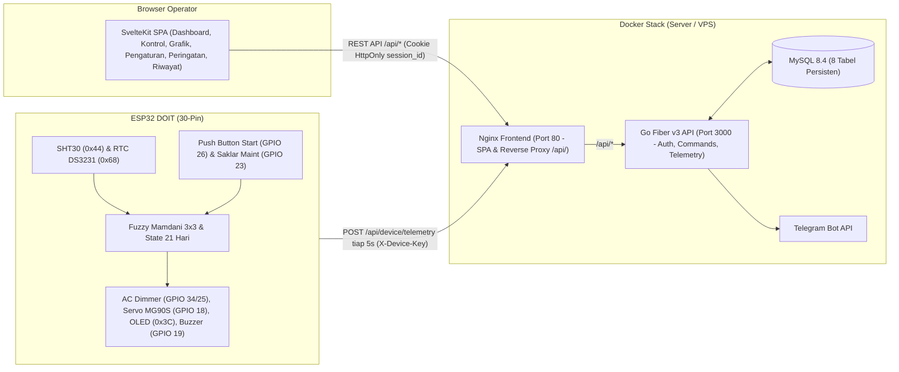

# Smart Hatchery IoT — Sistem Pemantauan & Kendali Inkubator Telur Otomatis

Sistem **Internet of Things (IoT)** *end-to-end* untuk memantau dan mengendalikan proses penetasan telur selama **siklus 21 hari** secara otomatis menggunakan **Logika Fuzzy Mamdani** pada **ESP32**, didukung REST API **Go Fiber v3 + MySQL 8.4**, antarmuka web reaktif **SvelteKit (Svelte 5) + Tailwind CSS v4**, serta orkestrasi kontainer **Docker Compose + Nginx**.

---

## Daftar Isi

1. [Fitur Utama](#-fitur-utama)
2. [Arsitektur Sistem](#-arsitektur-sistem)
3. [Struktur Repositori](#-struktur-repositori)
4. [Mapping Pin Hardware ESP32 DOIT (30-Pin)](#-mapping-pin-hardware-esp32-doit-30-pin)
5. [Cara Menjalankan Proyek (Quick Start)](#-cara-menjalankan-proyek-quick-start)
   - [Opsi A: Menggunakan Docker Compose (Direkomendasikan)](#opsi-a-menggunakan-docker-compose-direkomendasikan)
   - [Opsi B: Menjalankan Secara Manual (Development)](#opsi-b-menjalankan-secara-manual-development)
   - [Opsi C: Upload Firmware ke ESP32 (Arduino IDE)](#opsi-c-upload-firmware-ke-esp32-arduino-ide)
6. [Manajemen Akun Operator (CLI Injeksi User)](#-manajemen-akun-operator-cli-injeksi-user)
7. [Ringkasan Endpoint REST API](#-ringkasan-endpoint-rest-api)
8. [Panduan Deployment ke VPS Produksi](#-panduan-deployment-ke-vps-produksi)
9. [Dokumentasi Teknis Lebih Lanjut](#-dokumentasi-teknis-lebih-lanjut)

---

## Fitur Utama

### 1. Firmware Mikrokontroler (ESP32 DOIT 30-Pin)
- **Kendali Cerdas Logika Fuzzy Mamdani (2-Input, 2-Output, 9 Aturan):** Mengevaluasi matriks aturan linguistik `3x3` (*Fuzzifikasi* $\rightarrow$ *Implikasi MIN* $\rightarrow$ *Agregasi MAX* $\rightarrow$ *Defuzzifikasi Centroid / Titik Berat*) untuk mengatur intensitas bohlam pemanas (`0–100%` saat mode otomatis) dan sudut bukaan ventilasi servo MG90S (`0°–90°`) guna menjaga suhu optimal `37.5°C` (rentang aman `36.5°C – 38.5°C`), dilengkapi *passive humidity override* saat kelembapan melewati batas peringatan (`75% RH`).
- **Driver RobotDyn AC Dimmer Bebas Kedip (*IRAM-Safe*):** Menggunakan *hardware timer interrupt* periodik `100 µs` (`100` tick per setengah gelombang AC 50Hz `10.000 µs`) dan pemicu gerbang TRIAC `200 µs` via register `GPIO.out_w1ts`/`w1tc`, disertai pengaman `dimmerZCPaused` saat menulis ke memori flash NVS.
- **Manajemen Siklus 21 Hari Tahan Mati Listrik:** Menyimpan status siklus ke **NVS (Non-Volatile Storage)** dan menjaga akurasi waktu menggunakan kombinasi **RTC DS3231SN** (`0x68`) + sinkronisasi **NTP**. Otomatis membedakan **Fase Turning (Hari 1–18)** dan **Fase Lockdown (Hari 19–21)**.
- **Kontrol Lokal & Pengaman Jaringan:** Mendukung **Push Button Start** fisik (tekan singkat `< 2 detik` untuk mulai siklus, tekan tahan `>= 3 detik` untuk menghentikan siklus ke `idle`), **Saklar Maintenance**, alarm **Buzzer Aktif SFM-27**, layar **OLED 0.96" SSD1306**, serta **Auto-Rollback Wi-Fi 30 Detik** jika kredensial Wi-Fi baru gagal terhubung.

### 2. Backend Server (Go Fiber v3 + MySQL 8.4)
- **Keamanan Berlapis:**
  - Hashing kata sandi operator menggunakan **Argon2id** (`m=64MB, t=3, p=2`) dengan perbandingan waktu konstan (`subtle.ConstantTimeCompare`).
  - Sesi berbasis cookie `HttpOnly` dan `SameSite=Strict` (serta flag `Secure` untuk HTTPS).
  - Pembatasan percobaan login (`LoginRateLimiter`: maksimal **5 gagal per menit per IP** $\rightarrow$ HTTP `429`) dengan dukungan `TrustProxy` (`X-Forwarded-For`).
  - Enkripsi kredensial kata sandi Wi-Fi menggunakan **AES-256-GCM** (nonce acak 12-byte) yang bersifat *write-only* (tidak pernah dikembalikan lewat API maupun dicatat di log audit).
- **Validasi Keselamatan Aktuator:** Menolak perintah apabila perangkat berstatus *offline/stale* (`> 15 detik`), membatasi intensitas lampu manual maksimal `80%`, sudut ventilasi `0°–90°`, serta memblokir perintah `turn_now` saat siklus belum berjalan, sedang berputar, atau sudah memasuki fase *lockdown* (Hari 19–21).
- **Downsampling Grafik & Peringatan Multi-Kanal:** Menyediakan endpoint histori dengan perata-rataan otomatis (*bucketing downsampling*) sesuai `max_points`, pemantauan perangkat *stale* di latar belakang setiap `5 detik`, pencatatan `audit_logs`, serta integrasi opsional **Telegram Bot** untuk peringatan darurat (`severity = high`).

### 3. Frontend Web (SvelteKit SPA + Tailwind CSS v4)
- **Pemantauan Real-Time Anti Selisih Jam:** Melakukan polling telemetri tiap `5 detik` dan peringatan tiap `10 detik`, serta menghitung selisih waktu menggunakan `server_time` dari backend agar deteksi perangkat offline (`15 detik`) tetap presisi meskipun jam perangkat pengguna tidak sinkron.
- **Visualisasi & Evaluasi Stabilitas:** Dilengkapi komponen **Gauge** 5 zona warna, grafik **LineChart** multi-rentang (`1j`, `6j`, `24j`, `7h`), dan **EvaluasiKartu** yang menghitung skor kestabilan suhu/kelembapan berbasis persentase waktu dalam rentang aman dan RMSE.
- **Mode Simulasi (Mock Mode):** Dapat dijalankan tanpa backend maupun perangkat keras (`VITE_USE_MOCK=true`) dengan 4 skenario uji coba instan (`normal`, `stale`, `alert`, `finished`).

---

## Arsitektur Sistem



---

## Struktur Repositori

```text
.
├── ESP/
│   ├── sketch_nov6a/
│   │   └── sketch_nov6a.ino              # Firmware utama ESP32 DOIT (30-Pin)
│   └── PANDUAN_ARDUINO_DAN_FUZZY.md      # Panduan instalasi library Arduino & tabel Fuzzy Mamdani
├── backend/
│   ├── cmd/
│   │   ├── server/main.go                # Entrypoint REST API Go Fiber v3
│   │   └── create-user/main.go           # CLI untuk menambah/mengubah akun operator
│   ├── internal/
│   │   ├── config/                       # Loader environment variable & kunci AES
│   │   ├── crypto/                       # Argon2id password hashing & AES-256-GCM Wi-Fi
│   │   ├── database/                     # Koneksi MySQL, auto-migration, auto-seed, schema.sql
│   │   ├── handlers/                     # Handler Auth, Telemetry, Commands, Settings, Alerts, Audit
│   │   ├── middleware/                   # Session cookie auth, LoginRateLimiter, Device API key
│   │   ├── models/                       # Definisi struct request/response & entitas DB
│   │   └── services/                     # Notifikasi Telegram Bot
│   ├── Dockerfile                        # Multi-stage build Go (menghasilkan binary server & create-user)
│   ├── .env.example                      # Contoh konfigurasi environment backend lokal
│   └── README.md                         # Dokumentasi khusus modul backend
├── frontend/
│   ├── src/
│   │   ├── lib/                          # API client (api.js), Svelte 5 stores (.svelte.js), komponen & helper
│   │   └── routes/                       # Halaman SPA (/, /login, /kontrol, /grafik, /pengaturan, /peringatan, /riwayat)
│   ├── Dockerfile                        # Multi-stage build Node 22 -> Nginx Alpine
│   ├── nginx.conf                        # Konfigurasi SPA routing, security headers, & proxy /api/
│   ├── .env.example                      # Saklar VITE_USE_MOCK=true/false
│   └── README.md                         # Dokumentasi khusus modul frontend
├── docker-compose.yml                    # Orkestrasi MySQL 8.4, Backend Go Fiber, dan Frontend Nginx
├── .env.docker                           # Template environment variable untuk Docker Compose & VPS
└── DOKUMENTASI_SISTEM_LENGKAP.md         # Dokumentasi teknis mendalam seluruh lapisan kode
```

---

## Mapping Pin Hardware ESP32 DOIT (30-Pin)

| GPIO / Alamat | Nama Konstanta | Mode / Jalur | Perangkat Terhubung & Catatan |
| :--- | :--- | :--- | :--- |
| `VIN` / `5V` & `GND` | - | Power Utama | Terhubung ke `+5.0V` (Baut 1 & 2) dan `GND` Bersama (Baut 3 & 4) pada terminal TB-1512. |
| `3V3` | - | Power Sensor | Terhubung ke Baut 7 TB-1512 (`+3.3V`) untuk menyuplai SHT30, OLED, RTC, dan VCC logika Dimmer. |
| `GPIO 18` | `PIN_SERVO_MG90S` | PWM Output | Signal (Oranye) Motor Servo MG90S (`0°–90°`). *VCC & GND servo wajib diambil langsung dari TB-1512 `+5.0V` & `GND`.* |
| `GPIO 19` | `PIN_BUZZER_SFM27` | Digital Output | Kabel Merah (`+`) Buzzer Aktif SFM-27; kabel Hitam (`-`) ke GND Baseplate. |
| `GPIO 21` | `PIN_I2C_SDA` | I2C SDA | Dicabang di Baut 5 TB-1512 untuk SHT30 (`0x44`), OLED SSD1306 (`0x3C`), dan RTC DS3231 (`0x68`). |
| `GPIO 22` | `PIN_I2C_SCL` | I2C SCL | Dicabang di Baut 6 TB-1512 untuk SHT30 (`0x44`), OLED SSD1306 (`0x3C`), dan RTC DS3231 (`0x68`). |
| `GPIO 23` | `PIN_SW_MAINTENANCE` | `INPUT_PULLUP` | Saklar Maintenance (kaki 1 ke `GPIO 23`, kaki 2 ke `GND`). |
| `GPIO 25` | `PIN_DIMMER_DIM` | Digital Pulse | Pin `PWM / DIM` RobotDyn AC Dimmer (pemicu intensitas bohlam pemanas 60W). |
| `GPIO 26` | `PIN_BTN_START` | `INPUT_PULLUP` | Push Button Start (kaki 1 ke `GPIO 26`, kaki 2 ke `GND`). |
| `GPIO 34` | `PIN_DIMMER_ZC` | Input Interrupt | Pin `Z-C` (*Zero-Cross Detector*) RobotDyn AC Dimmer. |

---

## Cara Menjalankan Proyek (Quick Start)

### Opsi A: Menggunakan Docker Compose (Direkomendasikan)

Cara tercepat untuk menjalankan **MySQL 8.4 + Backend Go Fiber + Frontend Nginx** sekaligus:

1. Pastikan **Docker** dan **Docker Compose** sudah berjalan.
2. Jalankan stack dari direktori utama repositori:
   ```bash
   docker compose --env-file .env.docker up -d --build
   ```
   *(Atau salin `.env.docker` menjadi `.env`, lalu cukup jalankan `docker compose up -d --build`).*
3. Periksa status kontainer hingga ketiganya berstatus `healthy`:
   ```bash
   docker compose ps
   ```
4. Buka browser ke **`http://localhost`** dan masuk menggunakan akun operator bawaan:
   - **Username:** `operator1`
   - **Password:** `operator12345`

---

### Opsi B: Menjalankan Secara Manual (Development)

#### 1. Mencoba Tampilan Frontend Saja (Mode Mock / Tanpa Backend)
Jika hanya ingin meninjau UI/UX dan simulasi skenario tanpa menyalakan MySQL atau Go:
```bash
cd frontend
cp .env.example .env   # Pastikan berisi VITE_USE_MOCK=true
npm install
npm run dev
```
Buka **`http://localhost:5173`** dan login dengan `operator1` / `operator12345`. Di bagian bawah Dashboard tersedia pemilih skenario simulasi (`normal`, `stale`, `alert`, `finished`).

#### 2. Menjalankan Backend Go Fiber + Frontend Live
1. Nyalakan layanan **MySQL** lokal (misalnya melalui XAMPP/Laragon pada port `3306`).
2. Jalankan server **Backend Go Fiber** (otomatis membuat database, tabel, dan akun seed `operator1`):
   ```bash
   cd backend
   cp .env.example .env   # Sesuaikan DB_USER & DB_PASSWORD dengan MySQL lokal Anda
   go mod tidy
   go run ./cmd/server
   ```
3. Pada terminal terpisah, ubah `.env` di folder `frontend/` menjadi `VITE_USE_MOCK=false`, lalu jalankan:
   ```bash
   cd frontend
   npm run dev
   ```
   Vite akan meneruskan seluruh panggilan `/api/*` dari `http://localhost:5173` ke `http://localhost:3000`.

---

### Opsi C: Upload Firmware ke ESP32 (Arduino IDE)

1. Buka file [`ESP/sketch_nov6a/sketch_nov6a.ino`](./ESP/sketch_nov6a/sketch_nov6a.ino) di **Arduino IDE**.
2. Pasang *board manager* **`esp32` by Espressif Systems** dan pilih board **`DOIT ESP32 DEVKIT V1`**.
3. Instal 5 library berikut melalui *Library Manager*:
   - `ArduinoJson` (versi 7.x oleh Benoit Blanchon)
   - `Adafruit SHT31 Library` (oleh Adafruit)
   - `Adafruit SSD1306` + `Adafruit GFX Library` (oleh Adafruit)
   - `RTClib` (oleh Adafruit)
   - `ESP32Servo` (oleh Kevin Harrington / John K. Bennett)
4. Sesuaikan konfigurasi jaringan di bagian atas [`sketch_nov6a.ino`](./ESP/sketch_nov6a/sketch_nov6a.ino):
   - `DEFAULT_WIFI_SSID` & `DEFAULT_WIFI_PASS`: Wi-Fi awal tempat inkubator berada.
   - `BACKEND_TELEMETRY_URL`: arahkan ke alamat server Anda (contoh: `http://192.168.1.100:3000/api/device/telemetry` untuk dev lokal, atau `http://IP_VPS/api/device/telemetry` untuk Docker/VPS).
   - `DEVICE_API_KEY`: samakan persis dengan nilai `DEVICE_API_KEY` di `.env` backend.
5. Compile dan upload ke board ESP32. Detail rumus dan tabel aturan Fuzzy dapat dibaca di [`ESP/PANDUAN_ARDUINO_DAN_FUZZY.md`](./ESP/PANDUAN_ARDUINO_DAN_FUZZY.md).

---

## Manajemen Akun Operator (CLI Injeksi User)

Demi keamanan perangkat IoT, sistem tidak membuka endpoint registrasi publik. Untuk menambahkan akun operator baru atau mengubah kata sandi akun yang sudah ada, gunakan CLI `create-user`:

- **Melalui Docker (Lokal maupun VPS):**
  ```bash
  # Menambah akun operator baru
  docker exec -it smart-hatchery-backend ./create-user -username operator2 -password PasswordBaru123

  # Mereset kata sandi akun yang sudah terdaftar (gunakan flag -update)
  docker exec -it smart-hatchery-backend ./create-user -username operator1 -password PasswordBaru123 -update
  ```
- **Melalui Go secara langsung di lokal:**
  ```bash
  cd backend
  go run ./cmd/create-user -username operator2 -password PasswordBaru123
  ```

---

## Ringkasan Endpoint REST API

Seluruh rute berada di bawah prefix `/api`:

| Method & Endpoint | Autentikasi | Deskripsi |
| :--- | :--- | :--- |
| `GET /api/health` | Publik | Pemeriksaan status server & koneksi database (`200 OK`). |
| `POST /api/auth/login` | Publik + Rate Limit | Login operator (`5x/menit` per IP); menerbitkan cookie `session_id` (`HttpOnly`). |
| `POST /api/auth/logout` | Publik | Menghapus sesi di database dan membersihkan cookie. |
| `GET /api/auth/me` | Cookie Sesi | Mengambil profil operator yang sedang aktif. |
| `POST /api/device/telemetry` | Header `X-Device-Key` | Endpoint khusus ESP32 tiap 5 detik; menyimpan telemetri & membalas antrean perintah/pengaturan. |
| `GET /api/telemetry/latest` | Cookie Sesi | Mengambil snapshot telemetri terakhir beserta `server_time`. |
| `GET /api/telemetry/history` | Cookie Sesi | Mengambil data grafik (`?from=&to=&max_points=`) dengan *downsampling* otomatis. |
| `POST /api/commands` | Cookie Sesi | Mengirim perintah (`incubation`, `lamp`, `ventilation`, `turning`); membalas HTTP `202` (`dispatched`). |
| `GET /api/settings/device` | Cookie Sesi | Membaca target suhu, parameter motor, dan SSID Wi-Fi (tanpa membocorkan password Wi-Fi). |
| `GET /api/settings/limits` | Cookie Sesi | Membaca batas minimal/maksimal input pengaturan. |
| `GET /api/settings/thresholds` | Cookie Sesi | Membaca ambang batas keamanan suhu, kelembapan, dan `stale_seconds` (`15` detik). |
| `PUT /api/settings/target-temperature` | Cookie Sesi | Memperbarui target suhu inkubasi (`36.5°C – 38.5°C`). |
| `PUT /api/settings/motor` | Cookie Sesi | Memperbarui jadwal/parameter motor pembalik (mendukung payload penuh maupun parsial). |
| `PUT /api/settings/wifi` | Cookie Sesi | Mengenkripsi SSID & password Wi-Fi baru (AES-256-GCM) untuk dikirim ke ESP32. |
| `GET /api/alerts` | Cookie Sesi | Mengambil daftar peringatan (`active` dan `resolved`). |
| `GET /api/audit-logs` | Cookie Sesi | Mengambil riwayat audit dengan filter & paginasi (`?from=&to=&event=&page=&limit=`). |

---

## Panduan Deployment ke VPS Produksi

Konfigurasi [`docker-compose.yml`](./docker-compose.yml) dan [`frontend/nginx.conf`](./frontend/nginx.conf) telah disiapkan agar aman dijalankan di VPS:
- Port MySQL (`127.0.0.1:3306:3306`) dan Go Fiber (`127.0.0.1:3000:3000`) hanya terikat ke *loopback* lokal VPS sehingga tidak dapat diakses langsung dari internet luar.
- Seluruh trafik web dan `/api/*` melewati reverse proxy Nginx (`smart-hatchery-frontend`), dengan `TrustProxy` aktif di Go Fiber agar pembatasan login tetap membaca IP asli klien.

### Checklist Sebelum Meluncurkan di VPS:
1. **Salin `.env.docker` menjadi `.env` di VPS dan ganti seluruh kredensial bawaan:**
   - `MYSQL_ROOT_PASSWORD` & `DB_PASSWORD`
   - `APP_ENCRYPTION_KEY` (buat 64 karakter hex acak dengan `openssl rand -hex 32`)
   - `DEVICE_API_KEY` (samakan dengan `DEVICE_API_KEY` pada firmware ESP32)
   - `OPERATOR_PASSWORD`
2. **Sesuaikan Konfigurasi Domain / HTTPS:**
   - **Jika diakses langsung via HTTP IP VPS (`http://IP_VPS`):** biarkan `FRONTEND_PORT_BIND=80:80`, `COOKIE_SECURE=false`, dan `CORS_ALLOW_ORIGINS=http://IP_VPS`.
   - **Jika menggunakan Domain + HTTPS (Caddy / Nginx Host + Certbot):** atur `FRONTEND_PORT_BIND=127.0.0.1:8080:80` (arahkan reverse proxy HTTPS host ke `127.0.0.1:8080`), set `COOKIE_SECURE=true`, dan `CORS_ALLOW_ORIGINS=https://domain-anda.com`.
3. **Firewall VPS (UFW):** Buka hanya port `22/tcp` (SSH), `80/tcp` (HTTP), dan `443/tcp` (HTTPS).
4. **Jalankan Kontainer:**
   ```bash
   docker compose up -d --build
   ```

---

## Dokumentasi Teknis Lebih Lanjut

- [**`DOKUMENTASI_SISTEM_LENGKAP.md`**](./DOKUMENTASI_SISTEM_LENGKAP.md) — Penjelasan menyeluruh arsitektur, cara kerja kode Arduino, Backend, Frontend, diagram alur data, dan panduan belajar dari hulu ke hilir.
- [**`ESP/PANDUAN_ARDUINO_DAN_FUZZY.md`**](./ESP/PANDUAN_ARDUINO_DAN_FUZZY.md) — Detail perhitungan fungsi keanggotaan, matriks 9 aturan linguistik, dan defuzzifikasi Centroid Logika Fuzzy Mamdani pada ESP32.
- [**`backend/README.md`**](./backend/README.md) — Panduan pengembangan dan pengujian unit test modul Backend Go Fiber.
- [**`frontend/README.md`**](./frontend/README.md) — Panduan pengembangan antarmuka SvelteKit dan skenario data mock.
